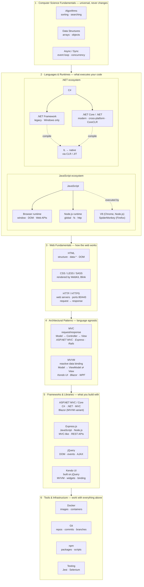
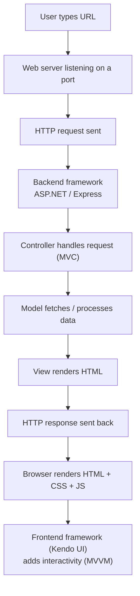

# Technology & Concepts Mind Map

> **Purpose**: A living document to visualize how all fundamental technologies and concepts connect. Use this to maintain mental clarity and trace relationships when deep in complex work.

## 🗺️ The Complete Map

Six layers, from the most universal at the top to the most specific at the bottom. Each layer builds on the one above it.



---

## 🔗 Critical Connection Points

### Connection 1: Language → Runtime
- **JavaScript** needs a **runtime** (Browser or Node.js) to execute
- **C#** needs a **runtime** (.NET Framework or .NET Core) to execute
- You can't run JavaScript or C# directly on hardware

### Connection 2: Runtime → Engine
- **Node.js** uses **V8 engine** to execute JavaScript
- **.NET** uses **CLR** to compile IL code to native code
- Engines/runtimes handle memory, garbage collection, execution

### Connection 3: Pattern → Framework
- **MVC pattern** is implemented by **ASP.NET MVC** and **Express**
- **MVVM pattern** is implemented by **Kendo UI** and **Blazor**
- Patterns are concepts; frameworks are implementations

### Connection 4: Framework → Language → Runtime
```
ASP.NET MVC  →  uses C#  →  runs on .NET Runtime
Express      →  uses JS   →  runs on Node.js Runtime
Kendo UI     →  uses JS   →  runs in Browser Runtime
```

### Connection 5: Web Stack



---

## 🧠 Mental Model Questions

Use these to test your understanding:

### "Where Am I?" Framework
When working on something, ask:

1. **What layer am I in?**
   - Fundamentals? Language? Pattern? Framework? Tool?

2. **What depends on what?**
   - Does Express depend on JavaScript? ✅ Yes
   - Does JavaScript depend on Express? ❌ No
   - Does MVC depend on C#? ❌ No (it's just a pattern)
   - Does ASP.NET MVC depend on C#? ✅ Yes

3. **Can I replace this?**
   - Can I replace Node.js with Deno? ✅ Yes (both JS runtimes)
   - Can I replace JavaScript with C# in Node.js? ❌ No
   - Can I use MVC with JavaScript? ✅ Yes (Express does this)

### Common Confusions - RESOLVED

| ❌ Confusion | ✅ Clarity |
|------------|-----------|
| "Is Node.js a language?" | No. JavaScript is the language. Node.js is a runtime. |
| "Is .NET a language?" | No. C# is the language. .NET is a framework/runtime. |
| "Is MVC only for .NET?" | No. MVC is a pattern used by many frameworks. |
| "Can I use jQuery without HTML?" | No. jQuery manipulates the DOM (HTML). |
| "Is Docker like a VM?" | Similar but lighter. Containers vs. Virtual Machines. |
| "Do I need .NET Framework for .NET Core?" | No. They're separate. .NET Core is the modern version. |

---

## 📊 Dependency Tree

### To Build an ASP.NET MVC App:
```
Your App
  └─ ASP.NET MVC Framework
       └─ C# Language
            └─ .NET Runtime
                 └─ Operating System (Windows/Linux/Mac)
```

### To Build an Express App:
```
Your App
  └─ Express Framework
       └─ JavaScript Language
            └─ Node.js Runtime
                 └─ V8 Engine
                      └─ Operating System
```

### To Use Kendo UI Widgets:
```
Your Web Page
  └─ Kendo UI Library
       └─ jQuery Library
            └─ JavaScript Language
                 └─ Browser Runtime
                      └─ Rendering Engine (Blink/WebKit)
```

---

## 🎯 Quick Reference Cheat Sheet

### "I Forgot the Basics" - Reset Points

| Topic | One-Liner | Page to Review |
|-------|-----------|----------------|
| **Algorithms** | Step-by-step instructions to solve problems | [Algorithms](fundamentals/algorithms.md) |
| **Event Loop** | How JS handles async without blocking | [Event Loop](languages/javascript/event-loop.md) |
| **HTTP** | Request/response protocol, ports 80/443 | [Web Servers](backend/web-servers.md) |
| **MVC** | Model-View-Controller separation pattern | [MVC](fundamentals/architecture-patterns/mvc.md) |
| **MVVM** | Observable data binding between VM and View | [MVVM](fundamentals/architecture-patterns/mvvm/index.md) |
| **DOM** | HTML structure that JS can manipulate | [HTML](web/html.md) |
| **CLR** | .NET's runtime that compiles IL to native | [C#](languages/csharp.md) |
| **V8** | Engine that executes JavaScript | *(not written yet)* |

### "What's the Difference?" - Common Pairs

| vs | Key Difference |
|----|----------------|
| **JavaScript vs Node.js** | Language vs Runtime |
| **C# vs .NET** | Language vs Framework |
| **.NET Framework vs .NET Core** | Legacy/Windows vs Modern/Cross-platform |
| **MVC vs MVVM** | Request/Response vs Reactive/Binding |
| **jQuery vs Kendo UI** | Low-level DOM vs High-level Widgets |
| **Browser vs Node.js** | Frontend runtime vs Backend runtime |
| **Docker vs VM** | Containers (light) vs Virtual Machines (heavy) |
| **NPM vs Packages** | Package manager vs Packages themselves |
| **Git vs GitHub** | Version control tool vs Hosting service |

---

## 🔄 Skill Retention Strategy

### Daily Work → Foundation Mapping

When you work on complex features, trace back to fundamentals:

**Example 1**: "Debugging Kendo MVVM data binding issue"
```
Kendo MVVM
  ↓ uses
Observable pattern
  ↓ which is
Property change detection
  ↓ which relies on
JavaScript objects (fundamental data structure)
  ↓ executed by
Browser's JavaScript engine
```

**Example 2**: "Building ASP.NET Core API endpoint"
```
ASP.NET Core API
  ↓ uses
MVC pattern (Controller)
  ↓ handles
HTTP requests
  ↓ which uses
Web server listening on ports
  ↓ written in
C# language
  ↓ compiled by
.NET runtime (CLR)
```

### Weekly Refresh Checklist

- [ ] Read one "Layer 1" file (algorithms, data structures, event loop)
- [ ] Trace one complex work task back to fundamentals
- [ ] Update this page with new connections discovered
- [ ] Review "Common Confusions" section - test yourself

---

**Remember**: Complexity is just layers of simplicity stacked together. When lost, trace down to a layer you're comfortable with, then work back up.
