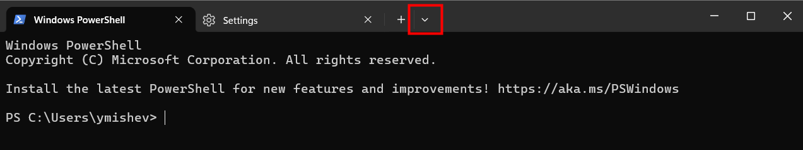
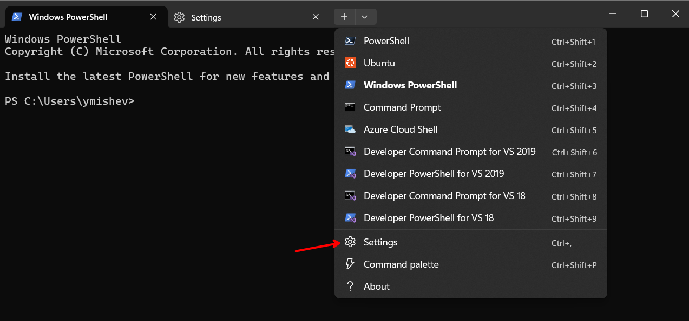
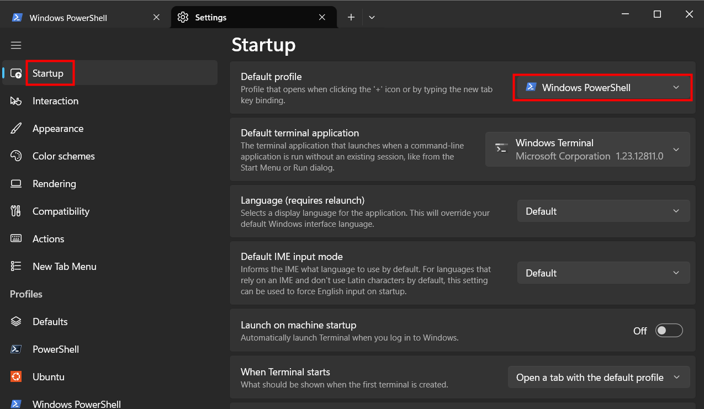
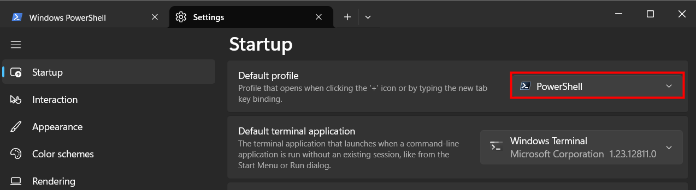
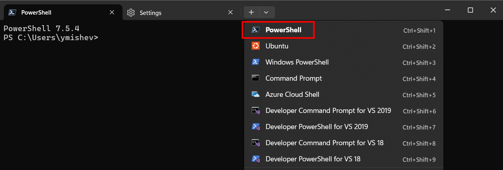
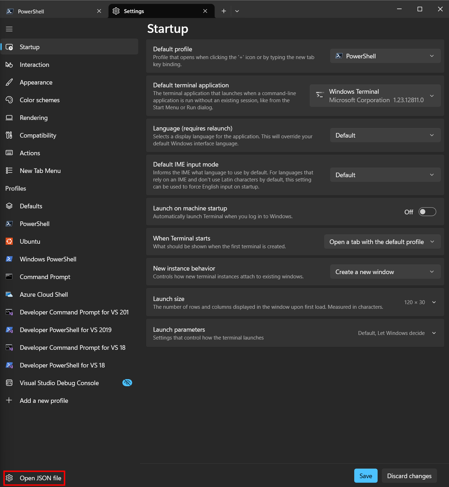
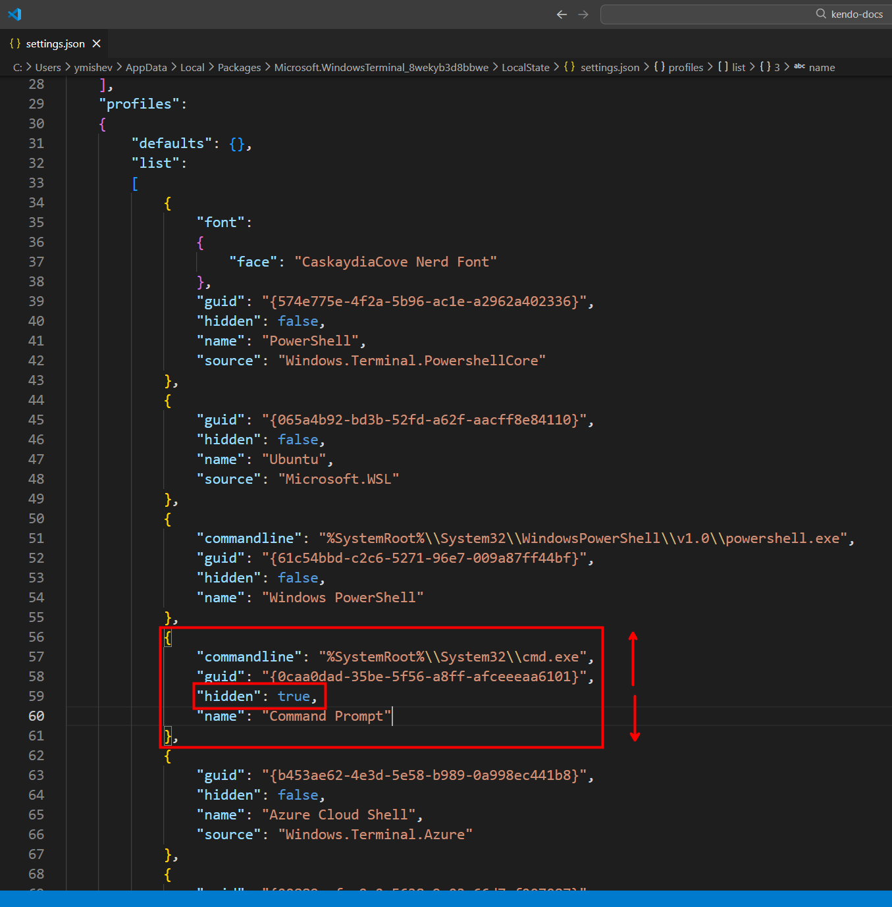

# Terminal vs Shell

A **terminal** and a **shell** are two distinct parts of a command-line interface that people often confuse because they live in the same window. The terminal is the **window you type into**; the shell is the **program that reads what you type and runs it**. The terminal is your entry point to the command line, and the shell is the tool that actually carries out your instructions.

This short video explains the distinction well: [Terminals and Shells Explained](https://youtu.be/QKBcHuA3VJE?si=0G0GBaEZJdR5Jnda).

## The chain: terminal → shell → OS

When you run a command, it travels through three layers:

```text
You ⇄ Terminal emulator ⇄ Shell ⇄ Operating system (kernel)
       (the window)        (bash/zsh/fish)   (does the actual work)
```

1. You type `ls` and press Enter.
2. The **terminal emulator** captures your keystrokes and draws the text on screen.
3. The **shell** (e.g. zsh) parses `ls`, finds the program, and runs it.
4. The **operating system** does the real work (reading the directory) and hands the result back up the chain to be displayed.

> **Key idea:** you can swap either layer independently. The same shell (zsh) runs inside many different terminals, and one terminal can run many different shells.

## What is a terminal emulator?

Originally a "terminal" was a physical device — a screen and keyboard wired to a mainframe. Today we use a **terminal emulator**: an app that emulates that old hardware in a window. Common ones:

- **macOS** — Terminal.app (built in), [iTerm2](https://iterm2.com/) (popular upgrade), Ghostty, WezTerm.
- **Linux** — GNOME Terminal, Konsole, Alacritty, Kitty.
- **Windows** — [Windows Terminal](https://aka.ms/terminal), the older Command Prompt window.
- **Inside editors** — VS Code and JetBrains IDEs ship an *integrated terminal*, which is a terminal emulator embedded in the editor.

The terminal emulator controls things like the font, colours, tabs, and window size. It does **not** decide which commands exist — that's the shell's job. See [Shells Compared](shells-compared.md) for the shells themselves.

## What is a shell?

The **shell** is the program that interprets your typed commands and runs them. There are several — Bash, Zsh, and Fish on macOS/Linux; PowerShell on Windows — each with its own syntax and features, all serving the same purpose: letting you drive the computer with text. The next page, [Shell Basics](shell.md), covers the everyday commands; [Shells Compared](shells-compared.md) covers how the shells differ and which to pick.

## Choosing / changing your shell

### On macOS / Linux

macOS has defaulted to **zsh** since macOS Catalina (2019); most Linux distros default to **bash**. To see which shell you're currently running:

```bash
echo $SHELL        # your default login shell, e.g. /bin/zsh
echo $0            # the shell running right now
```

To change your default login shell, use `chsh` (change shell). It only accepts shells listed in `/etc/shells`:

```bash
chsh -s /bin/zsh           # switch default shell to zsh
cat /etc/shells            # see the allowed shells
```

> **Tip:** changing your default shell takes effect in *new* terminal windows, not the one you're in.

### On Windows

Windows Terminal can host several shells (PowerShell, Command Prompt, Git Bash, WSL). You pick which one opens by default in its settings.

By default you'll have Windows PowerShell, Command Prompt, and Azure CLI installed, but you can add more profiles like Git Bash or Windows Subsystem for Linux (WSL). For instance, you can install the latest PowerShell from the Microsoft Store.

To change the default profile to the latest PowerShell:

1. Open Windows Terminal.
2. Click the down-arrow next to the plus (+) tab button.

3. Select **Settings** from the dropdown menu.

4. Go to **Startup > Default profile** and select PowerShell.


5. Save and open a new terminal to apply the change.


Now every new terminal opens PowerShell by default, and PowerShell is bolded in the dropdown to mark it as the default.

#### Reordering the terminal profiles

To reorder profiles in Windows Terminal you can edit the `settings.json` file directly: set the `"hidden"` property to `true` or `false` for each profile, and/or change the order of the profiles in the `"profiles"` array.

1. Open settings and open the JSON file via the **Open JSON file** button at the bottom left.

2. In the `"profiles"` array, locate the profiles you want to reorder or hide/expose.

In this example I have hidden the Command Prompt.

> **Note:** batch files (`.bat` / `.cmd`) are Windows scripts that run a series of commands — also used to set up aliases and environment variables, much like shell config files on macOS/Linux.

## Next steps

- [Shell Basics](shell.md) — the everyday commands, pipes, history, and shortcuts.
- [Shells Compared](shells-compared.md) — bash vs zsh vs fish, and what to use.
- [Customizing Your Shell](customizing-your-shell.md) — config files, prompts, aliases, and modern tools.
