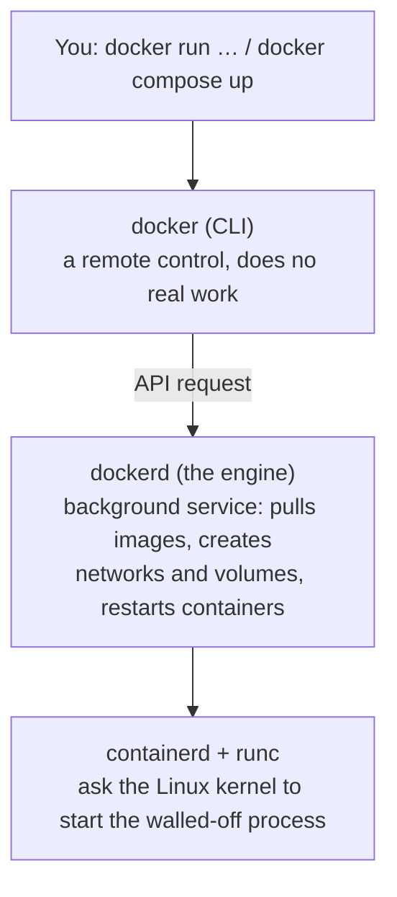

# Docker

Docker runs apps in **containers**: isolated, self-contained packages that hold the app plus everything it needs. You can run Jellyfin, a database or a web app without installing any of it on the machine itself.

## VMs vs containers

- **Virtualization**: carve out part of the host's hardware to run a completely separate machine (a VM) with **its own OS**. A **hypervisor** (VMware, VirtualBox) manages the VMs. Heavy, and slow to start.
- **Containerization**: run a normal process on the host's kernel, but walled off. It sees only its own files, network and processes. Nothing is emulated, so it starts in about a second. Setting this up by hand is hard, and Docker does it for you.

## The building blocks

| Term | What it is |
|---|---|
| **Dockerfile** | Text file with instructions for **building** an image |
| **Image** | The packaged app: a frozen minimal Linux filesystem + app + dependencies + a "run this on start" command. The blueprint |
| **Container** | A running instance of an image. Disposable: delete it and make a new one any time |
| **Registry** | Where images are published and downloaded from. **Docker Hub** is like GitHub for images (also `ghcr.io`) |
| **Volume** | A folder that lives outside the container, so data survives when the container is deleted |

```dockerfile
FROM debian:bookworm-slim          # start from a tiny Debian
RUN apt-get install -y ffmpeg      # add dependencies
COPY ./jellyfin /jellyfin          # add the app itself
EXPOSE 8096                        # it listens on port 8096
CMD ["/jellyfin/jellyfin"]         # what to run on start
```

!!! tip "Containers are disposable, volumes are permanent"
    To update an app, delete the old container and create a new one from the newer image. It plugs into the same volume folders and carries on as if nothing happened. Back up the volumes and the compose file, not the containers.

## How Docker is put together

"Docker" is really several pieces:



Because `dockerd` runs as a system service, containers keep running after you log out and come back after a reboot.

## `docker run` vs `docker compose`

Both are subcommands of the same `docker` CLI and both send requests to the same engine.

- **`docker run`** is the manual way: start **one** container, with all settings typed as flags. Nothing is saved.
- **`docker compose`** reads an instruction file (`compose.yaml` / `docker-compose.yml`) and starts **one or many** containers from it.

The same Jellyfin setup, written both ways:

=== "docker run"

    ```bash
    docker run -d --name jellyfin \
      -p 8096:8096 \
      -v /mnt/data/jellyfin/config:/config \
      -v /mnt/data/media:/media:ro \
      -e TZ=Europe/Sofia \
      --restart unless-stopped \
      jellyfin/jellyfin:latest
    ```

=== "docker-compose.yml"

    ```yaml
    services:
      jellyfin:
        image: jellyfin/jellyfin:latest
        container_name: jellyfin
        ports:
          - "8096:8096"
        volumes:
          - /mnt/data/jellyfin/config:/config
          - /mnt/data/media:/media:ro
        environment:
          - TZ=Europe/Sofia
        restart: unless-stopped
    ```

| | `docker run` | `docker compose` |
|---|---|---|
| Settings live in | flags you type each time | a saved YAML file |
| Works on | one container | every service in the file at once |
| Network between services | you create it by hand | made automatically |
| To change something | stop, remove, retype the command | edit the file, run `up -d` again |

!!! note "`docker-compose` with a hyphen"
    Compose used to be a separate Python program called `docker-compose`. It's now a plugin of the CLI, typed `docker compose` with a space. Same YAML, same purpose. Old guides still show the hyphen.

Use Compose even for a single container: the settings are saved, can be backed up, and changing something means editing one line. Keep `docker run` for quick tests like `docker run --rm hello-world` (`--rm` deletes the container when it exits).

## What `docker compose up -d` does

1. **Reads** the compose file in the current folder.
2. **Pulls** the images that aren't on the machine yet (downloaded once).
3. Creates a private **network**, so services in the file reach each other by service name (e.g. `http://jellyfin:8096`, `db:5432`).
4. **Creates** each container from its image, with your ports, volumes and environment.
5. **Starts** the image's `CMD` inside the walls, and forwards host ports into the container.

`-d` (detached) means "run in the background."

## Commands

=== "Compose (run inside the stack's folder)"

    | Command | What it does |
    |---|---|
    | `docker compose up -d` | Create/start everything in the file. Re-run after editing: only changed services are recreated |
    | `docker compose down` | Stop and remove the containers and network. **Volume data stays** |
    | `docker compose pull && docker compose up -d` | Update to the newest images |
    | `docker compose logs -f [service]` | Follow the app output (`Ctrl+C` to exit) |
    | `docker compose ps` | List this stack's containers |
    | `docker compose restart [service]` | Restart without recreating |
    | `docker compose stop` / `start` | Stop/start without removing |

=== "Plain docker (works on any container)"

    | Command | What it does |
    |---|---|
    | `docker ps` (`-a` for stopped too) | List containers |
    | `docker logs -f jellyfin` | Follow a container's output |
    | `docker exec -it jellyfin bash` | Open a shell inside a running container |
    | `docker stop` / `start` / `rm jellyfin` | Stop / start / delete a container |
    | `docker pull jellyfin/jellyfin` | Just download an image |
    | `docker images` | List downloaded images |
    | `docker image prune` | Delete unused images to free disk space |
    | `docker build -t myapp .` | Build an image from the Dockerfile in this folder |

## Compose file: most used properties

Each name under `services:` is one container. That name is also its **hostname** on the stack's network.

| Property | Example | What it does |
|---|---|---|
| `image` | `jellyfin/jellyfin:latest` | Which image to run: `account/name:tag`. `latest` = newest when pulled; pin a version (`:10.11.0`) for controlled updates |
| `build` | `.` | Build the image from a Dockerfile instead of downloading one |
| `container_name` | `jellyfin` | Name shown in `docker ps` (otherwise auto-generated, e.g. `jellyfin-jellyfin-1`) |
| `ports` | `"8096:8096"` | `HOST:CONTAINER`. Only the left number is yours to change. Add `/udp` for UDP (default is TCP) |
| `volumes` | `./config:/config` | `HOST_FOLDER:CONTAINER_FOLDER`. `./` = next to the compose file. Add `:ro` for read-only |
| `environment` | `TZ=Europe/Sofia` | Settings passed to the app. Which ones exist depends on the app's docs |
| `env_file` | `tailscale.env` | Same, but read from a file. Keeps secrets out of the compose file |
| `restart` | `unless-stopped` | What to do after a crash or reboot (table below) |
| `user` | `1000:1000` | `UID:GID` to run as, so files in your folders are owned by you, not root |
| `depends_on` | `[db]` | Start these services first (e.g. the database before the app) |
| `networks` | `[backend]` | Which networks the container joins (default: the stack's own network) |
| `network_mode` | `service:tailscale` | Share another container's network instead of having its own |
| `devices` | `/dev/net/tun:/dev/net/tun` | Pass hardware through (GPU, USB, tunnel device) |
| `cap_add` | `[net_admin]` | Grant extra Linux permissions. Only for images you trust |
| `healthcheck` | `test: ["CMD", "curl", "-f", "http://localhost"]` | Command Docker runs to check the app is actually healthy |

### `restart` values

| Value | Behaviour |
|---|---|
| `no` | Never restart (default) |
| `always` | Always restart, even if you stopped it manually (comes back after reboot) |
| `unless-stopped` | Like `always`, but stays stopped if you stopped it yourself. **The usual choice** |
| `on-failure` | Restart only if it exits with an error |

### Value formats

| Pattern | Meaning |
|---|---|
| `8096:8096` | host port → container port (TCP) |
| `7359:7359/udp` | same, UDP |
| `./config:/config` | folder next to the compose file → `/config` inside |
| `/mnt/data/media:/media:ro` | absolute host path, read-only inside |
| `[a, b]` | short YAML list, same as `- a` and `- b` on separate lines |
| `# ...` | comment, ignored |

## Example: Jellyfin stack

A real stack from my Raspberry Pi. It runs two containers: Jellyfin, and a Tailscale "sidecar" that gives Jellyfin its own HTTPS address on the tailnet.

```yaml
services:
  jellyfin:
    image: jellyfin/jellyfin:latest
    container_name: jellyfin
    user: 1000:1000                     # run as me, so config files are mine
    restart: unless-stopped
    ports:
      - 8096:8096                       # web UI + apps
      - 7359:7359/udp                   # lets apps on the LAN discover the server
    environment:
      - TZ=Europe/Sofia
      - JELLYFIN_PublishedServerUrl=http://ungabunga:8096   # address given to discovering apps
    volumes:
      - ./config:/config                # users, watch history, library DB: back this up
      - ./cache:/cache                  # thumbnails, safe to delete
      - /mnt/data/media/movies:/media/movies:ro   # media read-only: Jellyfin can't change it
      - /mnt/data/media/shows:/media/shows:ro

  tailscale:
    image: tailscale/tailscale:stable
    container_name: jellyfin-tailscale
    env_file: tailscale.env             # TS_AUTHKEY, only needed on first start
    environment:
      - TS_HOSTNAME=jellyfin            # → jellyfin.<tailnet>.ts.net
      - TS_STATE_DIR=/var/lib/tailscale
      - TS_SERVE_CONFIG=/config/serve.json   # "proxy HTTPS :443 → http://jellyfin:8096"
    volumes:
      - ./tailscale/state:/var/lib/tailscale  # keeps it logged in across restarts
      - ./tailscale/config:/config:ro
    devices:
      - /dev/net/tun:/dev/net/tun       # needs the tunnel device for the VPN
    cap_add: [net_admin, sys_module]
    restart: unless-stopped
```

How requests reach Jellyfin:

- **At home:** TV app → `ungabunga:8096` → `ports` → Jellyfin.
- **Remote:** `https://jellyfin.<tailnet>.ts.net` → Tailscale container → `http://jellyfin:8096` over the stack's private network. This path never uses `ports:`; one container talks to another by service name.

Inside the container, Jellyfin only sees `/config`, `/cache` and `/media/...`. That's why its libraries point at `/media/movies`, not `/mnt/data/media/movies`.
