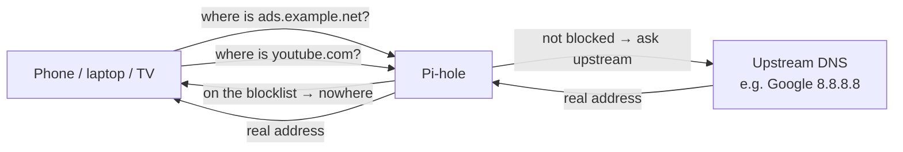
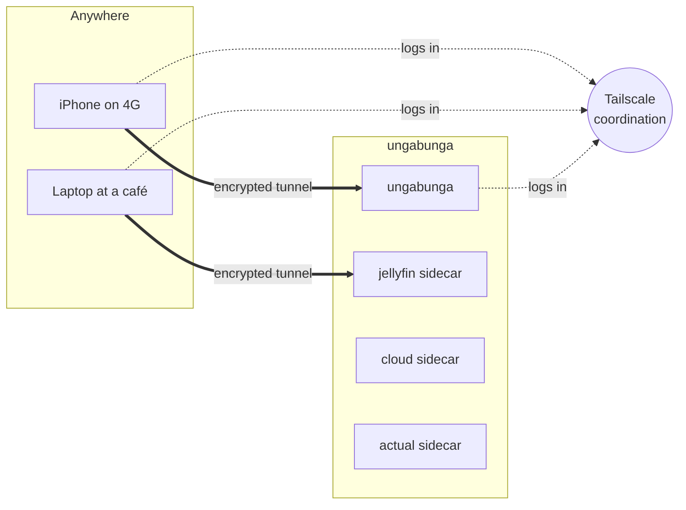

# Home Network: Pi-hole and Tailscale

How DNS and remote access work in the home lab. Every service runs as a Docker container on the Pi (`ungabunga`), and two tools decide how devices reach them:

- **Pi-hole** decides what devices are allowed to *look up*: it's the network's phone book, with ads crossed out.
- **Tailscale** decides who can *reach* the Pi and from where: a private network that works anywhere.

They're linked: Tailscale tells every device to use Pi-hole for lookups, so ad blocking follows you away from home.

## Three basics

| Term | Plain meaning | In the home lab |
|---|---|---|
| **IP address** | A device's street address | The router hands out `192.168.x.x` addresses at home. The Pi has a fixed one |
| **Port** | A numbered door on a device | One door per service: `8096` Jellyfin, `3000` BookOrbit, `3001` Homepage… Docker connects each door to a container |
| **DNS** | The internet's phone book: turns `youtube.com` into an IP address | Every website visit starts with a DNS question. Pi-hole answers them |

!!! note "Docker port mapping"
    `"3001:3000"` in a compose file means "door 3001 on the Pi leads to door 3000 inside the container". That's why two containers can both use 3000 inside but must use different doors on the Pi.

## Pi-hole: the phone book with ads crossed out

Before a device loads anything, it asks a DNS server for the address. On this network that server is Pi-hole.



- Pi-hole holds a blocklist of about **300,000 ad and tracker domains**. Ask for one of them and it answers "doesn't exist", so the ad never loads: on every device, no app needed.
- For everything else it asks an **upstream** DNS server (Google's here) and passes the answer back.
- **It only answers lookups.** Video and web traffic never pass through Pi-hole, so it doesn't slow the connection.
- **How devices find it:** the router's DHCP settings (the part that hands out addresses) give devices the Pi's address as their DNS server.
- The admin page shows every query, which device asked, and what was blocked: `http://ungabunga:8081/admin`.

!!! warning "If the Pi is off, websites stop opening"
    The internet still works, but nothing can look up addresses. Fixes:

    - Give the router a **second DNS server** as a backup in its DHCP settings.
    - On a single device: turn Tailscale off, or set its DNS by hand.

    This is also why Pi-hole runs from the SD card, not the external SSD: DNS keeps working if the SSD fails.

## Tailscale: a private network that follows your devices

Normally "on the home network" means "on the home Wi-Fi". Tailscale adds a second, private network on top of the internet, called the **tailnet**. Only devices logged into your account can join.



- **Every device gets a `100.x.y.z` address** that works from anywhere: home, office, mobile data.
- **The router has no open doors.** Each device connects *outwards*; Tailscale introduces them and they build encrypted (WireGuard) tunnels between each other. Someone scanning the internet sees nothing.
- **MagicDNS** gives each device a name, so `ungabunga` works instead of a `100.x` address. Full names look like `ungabunga.<tailnet>.ts.net`.

### Sidecars: one Tailscale device per service

Jellyfin, Nextcloud and Actual Budget each have a small `tailscale` container next to them in their compose file. Each sidecar joins the tailnet as **its own device** (`jellyfin`, `cloud`, `actual`) and forwards requests to its app.

| What a sidecar gives | Why it matters |
|---|---|
| **HTTPS** with a real certificate (`https://jellyfin.<tailnet>.ts.net`) | Actual Budget refuses to run without HTTPS; Nextcloud's apps want it |
| **Sharing just one service** | Share the `jellyfin` device with family and they see Jellyfin only. Sharing `ungabunga` would hand them every door on the Pi |

The forwarding rule lives in `serve.json` and says, in effect, "HTTPS traffic for this name → `http://jellyfin:8096`".

!!! info "Serve vs Funnel"
    **Serve** publishes a service *inside the tailnet only*. **Funnel** would publish it to the whole public internet. Funnel is off everywhere in this setup, so nothing is public.

## How they fit together

In the Tailscale admin console (**DNS → Nameservers**), the tailnet's DNS server is set to **the Pi's Tailscale address, which is Pi-hole**.

| Where the device is | Who answers its DNS questions | Result |
|---|---|---|
| At home, Tailscale off | Pi-hole (the router said so) | Ads blocked |
| At home, Tailscale on | Pi-hole, through Tailscale | Ads blocked |
| Away, Tailscale on | Pi-hole, through the tunnel | **Ads blocked on mobile data too** |
| Away, Tailscale off | Whatever network you're on | No blocking, no home services |

Names ending in `.ts.net` skip Pi-hole and go to Tailscale's own DNS. That's how `jellyfin.<tailnet>.ts.net` always resolves.

## Two walkthroughs

=== "Jellyfin at a friend's house"

    ```mermaid
    sequenceDiagram
        participant P as iPhone (Tailscale on)
        participant D as Tailscale DNS
        participant S as jellyfin sidecar
        participant J as Jellyfin container
        P->>D: where is jellyfin.(tailnet).ts.net?
        D-->>P: 100.x.y.z
        P->>S: HTTPS request (inside the encrypted tunnel)
        S->>J: http://jellyfin:8096
        J-->>S: video
        S-->>P: video (back through the tunnel)
    ```

    The friend's Wi-Fi only sees scrambled traffic to some address. It can't tell what's inside.

=== "A news site at home"

    ```mermaid
    sequenceDiagram
        participant L as Laptop
        participant H as Pi-hole
        participant U as Upstream DNS
        L->>H: where is news-site.com?
        H->>U: (not blocked) where is news-site.com?
        U-->>H: address
        H-->>L: address
        L->>H: where are the 15 ad domains?
        H-->>L: "doesn't exist" ×15
        Note over L: page loads, blank spaces where ads were
    ```

## Which link to use

| Service | At home | Away (Tailscale on) |
|---|---|---|
| Homepage, Uptime Kuma, Portainer, Pi-hole, BookOrbit | `http://ungabunga:<port>` | same link |
| Jellyfin | `http://ungabunga:8096` | `https://jellyfin.<tailnet>.ts.net` |
| Nextcloud | Tailscale only (no port on the Pi) | `https://cloud.<tailnet>.ts.net` |
| Actual Budget | needs HTTPS, so use the Tailscale link | `https://actual.<tailnet>.ts.net` |

!!! tip "`ungabunga` doesn't resolve?"
    The short name comes from Tailscale's MagicDNS. Without Tailscale, use the Pi's LAN IP address instead: `http://<pi-lan-ip>:<port>`.

## Quick checks

```bash
# On any device on the tailnet: who's online, and is the connection direct or relayed?
tailscale status
tailscale ping ungabunga

# On the Pi: what DNS config Tailscale pushes
tailscale dns status

# In a sidecar: what it serves, and that Funnel is off ("tailnet only")
docker exec jellyfin-tailscale tailscale serve status

# Ask Pi-hole directly (from a Mac on the home network)
dig @<pi-lan-ip> youtube.com          # real address
dig @<pi-lan-ip> doubleclick.net      # 0.0.0.0 → blocked
```

Related: [Docker](docker.md), [Homepage Dashboard](homepage.md).
