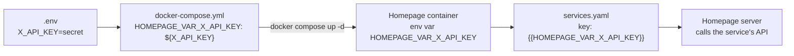

# Homepage Dashboard

[Homepage](https://gethomepage.dev) is a self-hosted start page. It runs in Docker on the Pi (`ungabunga`) at **http://ungabunga:3001**. It shows a card for each service, live stats from several of them, and the Pi's health on the top bar.

Everything is driven by a few YAML files. There is no settings screen: you edit a file, save it, and refresh the browser.

## Folder layout

```
~/docker/homepage/
├── docker-compose.yml   # how the container runs: ports, folders, secret names
├── .env                 # the secret values (passwords, API keys, tokens)
├── images/              # background image(s), served as /images/<file>
└── config/              # the dashboard itself (YAML + CSS)
    ├── settings.yaml
    ├── services.yaml
    ├── widgets.yaml
    ├── bookmarks.yaml
    └── custom.css
```

- Port **3001** on the Pi goes to port 3000 inside the container. Port 3000 on the Pi is already taken by BookOrbit.
- The Docker socket is mounted into the container, so each card can show its container's status (running, stopped).

## Which file controls what

| File | Controls | Example change |
|---|---|---|
| `config/settings.yaml` | Title, theme, colour, background, group layout | `color: indigo`, `columns: 4` |
| `config/services.yaml` | The service cards and their live widgets | Add a card, change a widget's `fields` |
| `config/widgets.yaml` | The top bar: Pi stats, clock, search | Add a disk, change the clock format |
| `config/bookmarks.yaml` | Link tiles | A link with `abbr: XY` and `href:` |
| `config/custom.css` | Styling the YAML can't do | Top-bar layout (see below) |
| `images/` | Image files the page can show | Background as `/images/background.png` |
| `docker-compose.yml` | Ports, mounted folders, which secrets go in | Mount a new drive, add a secret name |
| `.env` | Secret values only | A new API key or token |

Icons in `services.yaml` can be `name.png` from [dashboard-icons](https://github.com/walkxcode/dashboard-icons) (e.g. `jellyfin.png`), `mdi-<name>` ([Material Design Icons](https://pictogrammers.com/library/mdi/)), or any image URL.

## Refresh or restart?

Edits inside `config/` or `images/` only need a browser refresh. Edits to `docker-compose.yml` or `.env` need the container recreated.

| You changed | What to do |
|---|---|
| Any file in `config/` | Save, then refresh the browser |
| A file in `images/` | Refresh the browser |
| `docker-compose.yml` or `.env` | `cd ~/docker/homepage && docker compose up -d` |

!!! warning "`docker restart` is not enough"
    `docker compose up -d` recreates the container with the new settings. `docker restart homepage` reuses the old ones, so new secrets never arrive.

!!! tip "Change not showing?"
    Hard-refresh with Cmd+Shift+R. An old browser tab keeps running the previous version of the page.

## Secrets: how they reach a widget

Secret values live only in `.env`. Every other file refers to them **by name**, so the names must match exactly at each step.



The value is filled in on the server. The browser only receives the results, never the key.

### Recipe for a new secret

1. Add the value to `.env`: `X_API_KEY=...` (one per line, no quotes or spaces).
2. In `docker-compose.yml`, under `environment:`, add `HOMEPAGE_VAR_X_API_KEY: ${X_API_KEY}`. The name inside `${...}` is the name from `.env`.
3. In `config/services.yaml`, in the widget, write `key: {{HOMEPAGE_VAR_X_API_KEY}}`. Never the real value.
4. Run `docker compose up -d` in `~/docker/homepage`.
5. Check it arrived. This lists the names only, not the values:
   ```bash
   docker exec homepage env | grep -o '^HOMEPAGE_VAR_[A-Z_]*'
   ```

### Rules that keep it safe

- `.env` stays next to `docker-compose.yml`, never in `config/`. The container can read everything in `config/`.
- `.env` is readable only by your user: `chmod 600 .env`.
- Prefer a read-only API key or token over a username and password.
- Delete values from `.env` that nothing uses any more.
- Use a different password for each service.

## Service widgets

Each widget logs in to its service in its own way, and most have one quirk.

| Service | Logs in with | Gotcha |
|---|---|---|
| Pi-hole | Web password | Needs `version: 6` for Pi-hole v6. |
| Jellyfin | API key (Dashboard → API Keys) | Jellyfin 10.12 and newer need `version: 2`. Without it every call is a 404 and the key ends up in Homepage's logs. |
| BookOrbit | Username + password | Uses a full login. Prefer an API key or a separate user if available. |
| Nextcloud | Server info token (read-only) | With 2FA on the account, a normal password is always refused (`997 Unauthorised`). Use the token and `key:`. |
| Uptime Kuma | Nothing (public status page) | `slug:` = the status page's slug. |
| UniFi | Local **View Only** account (or an API key) | The main admin account has 2FA, so login fails with code `499`. Create a separate local-only account. |
| Tailscale | API access token (admin console → Settings → Keys) | Tokens expire after at most 90 days, then the card errors. Make a new one and update `.env`. |

Example, the Jellyfin card:

```yaml
- Jellyfin:
    icon: jellyfin.png
    href: http://ungabunga:8096
    description: Movies, shows & courses
    server: local
    container: jellyfin
    widget:
      type: jellyfin
      version: 2
      url: http://ungabunga:8096
      key: {{HOMEPAGE_VAR_JELLYFIN_API_KEY}}
      enableNowPlaying: true
      enableMediaControl: false
```

### Widget fields

A widget shows up to 4 values, in the order listed in `fields: [...]`. Extra ones are dropped.

- BookOrbit: `books`, `authors`, `series`, `storage`, `reading`, `finished`
- Nextcloud: `freespace`, `activeusers`, `numfiles`, `numshares` (more in the [widget docs](https://gethomepage.dev/widgets/services/nextcloud/))

### UniFi

The `unifi` widget reads the UniFi console (here a Cloud Gateway Ultra) and shows one summary for the whole network, not each device.

| Field | Shows |
|---|---|
| `uptime` | Gateway uptime |
| `wan` | Internet connection status |
| `lan` / `wlan` | Wired / Wi-Fi health |
| `lan_users` / `wlan_users` | Wired / Wi-Fi client count |
| `lan_devices` / `wlan_devices` | Switches / access points online |

```yaml
- UniFi:
    icon: unifi.png
    href: https://<gateway-ip>
    widget:
      type: unifi
      url: https://<gateway-ip>
      username: {{HOMEPAGE_VAR_UNIFI_USERNAME}}
      password: {{HOMEPAGE_VAR_UNIFI_PASSWORD}}
      fields: ["wan", "lan_devices", "wlan_users", "lan_users"]
```

The account: UniFi → **Settings → Admins & Users → Create New Admin**, tick **Restrict to local access only**, and give it **View Only** for Network and no other permissions. Local-only accounts skip 2FA, which Homepage can't answer.

For per-device status (each switch or access point), add a ping monitor per device in Uptime Kuma instead.

**Top-bar version.** `unifi_console` in `widgets.yaml` shows a compact summary (uptime, internet status, wired and Wi-Fi) next to the Pi stats. It has no `fields` option and reuses the same secrets:

```yaml
- unifi_console:
    url: https://<gateway-ip>
    username: {{HOMEPAGE_VAR_UNIFI_USERNAME}}
    password: {{HOMEPAGE_VAR_UNIFI_PASSWORD}}
```

### Tailscale

Shows one machine's Tailscale address, when it was last seen, and when its machine key expires.

```yaml
- Tailscale:
    icon: tailscale.png
    href: https://login.tailscale.com/admin/machines
    widget:
      type: tailscale
      deviceid: <device-id>
      key: {{HOMEPAGE_VAR_TAILSCALE_API_KEY}}
      fields: ["address", "last_seen", "expires"]
```

- `deviceid`: run `tailscale status --json` on the machine and take `Self.ID`, or copy it from the machine's page in the admin console.
- The API token lasts at most 90 days. Note the date and renew it before then.
- For a server, turn off **key expiry** for the machine (Machines → ⋯ → Disable key expiry). Otherwise it drops off the tailnet when the key expires.

### Nextcloud token

Nextcloud's **serverinfo** app can accept its own token instead of an account. The token can only read stats: it can't open files or log in.

```bash
TOKEN=$(openssl rand -hex 24)
docker exec -u www-data nextcloud php occ config:app:set serverinfo token --value "$TOKEN"
echo "NEXTCLOUD_TOKEN=$TOKEN" >> ~/docker/homepage/.env
```

Then wire it up with the recipe above (`HOMEPAGE_VAR_NEXTCLOUD_TOKEN`, `key:` in the widget). To change it, run the same commands with a new value.

## Customisations

### Background image

Homepage only serves images from `/app/public/images` inside the container, so a host folder is mounted there:

```yaml
# docker-compose.yml → volumes:
- ./images:/app/public/images
```

```yaml
# settings.yaml
background:
  image: /images/background.png
  blur: sm          # none, sm, md, xl
  brightness: 75    # lower = darker, text easier to read
  opacity: 50       # 0-100
cardBlur: md        # frosted-glass cards
```

To swap the image from the Mac, then refresh:

```bash
scp ~/Downloads/new.png ungabunga:docker/homepage/images/background.png
```

### A second disk on the top bar

The container can only measure disks it can see. Mount the drive read-only, list it in `widgets.yaml`, then run `docker compose up -d`:

```yaml
# docker-compose.yml → volumes:
- /mnt/data:/mnt/data:ro
```

```yaml
# widgets.yaml
- resources:
    disk: [/, /mnt/data]
```

### Clock

One short line, e.g. `14 Nov, 21:47`:

```yaml
# widgets.yaml
- datetime:
    text_size: md
    locale: en-GB
    format:
      day: numeric
      month: short
      hour: 2-digit
      minute: 2-digit
      hourCycle: h23
```

Add `weekday: short` for `Sat 14 Nov`, or delete `day` and `month` for time only. Add `second: 2-digit` for seconds. `format` takes any [`Intl.DateTimeFormat`](https://developer.mozilla.org/en-US/docs/Web/JavaScript/Reference/Global_Objects/Intl/DateTimeFormat/DateTimeFormat#options) option.

### Weather

`openmeteo` adds the current weather to the top bar. It needs no account or API key.

```yaml
# widgets.yaml
- openmeteo:
    label: Sofia
    latitude: 42.6977
    longitude: 23.3219
    timezone: Europe/Sofia
    units: metric
    cache: 15          # minutes between updates
    format:
      maximumFractionDigits: 0
```

### Top-bar layout

Homepage puts the clock, weather and search in one right-hand group, so search normally shares their row. This `custom.css` gives two rows instead: Pi stats, UniFi, date and weather on top, and search alone below.

```css
#information-widgets-right { display: contents; }                                  /* split the right-hand group */
#information-widgets-right > .information-widget-datetime { margin-left: auto; }  /* date + weather to the right */
.information-widget-search { flex-basis: 100%; order: 99; }                       /* search last, full width */
```

Row 1 has little room left. If the weather wraps to its own line on a narrow screen, shorten the date or remove the weather `label`.

## Troubleshooting

Most widget errors are a misspelt name or a missing `docker compose up -d`. Check those first.

| Symptom on the card | Likely cause | Fix |
|---|---|---|
| "API Error" right after adding a widget | A name doesn't match between `.env`, compose and `services.yaml` | Compare the three names letter by letter |
| Same, and the names are right | Container not recreated since `.env` or compose changed | `docker compose up -d` |
| `Failed to execute 'json' on 'Response': Unexpected end of JSON input` | The service returned an empty error, often a 404 from an outdated API | Jellyfin: add `version: 2`. Others: check the widget's docs for a `version` option |
| `HTTP Error` with `statuscode 997 Unauthorised` | Nextcloud refused the login | Use the serverinfo token; passwords fail with 2FA |
| A config change doesn't show | Browser running the old page | Hard refresh |

Useful commands on the Pi. They print names and errors, not secret values:

```bash
cd ~/docker/homepage
docker exec homepage env | grep -o '^HOMEPAGE_VAR_[A-Z_]*'   # which secrets arrived
docker logs homepage --since 10m 2>&1 | grep -i error        # recent errors
docker inspect homepage --format '{{.State.StartedAt}}'      # when it was last (re)created
```

!!! warning "Keys in the logs"
    Error logs can contain a full request URL, sometimes with a key in it. `docker compose up -d --force-recreate` starts a fresh container with empty logs.
